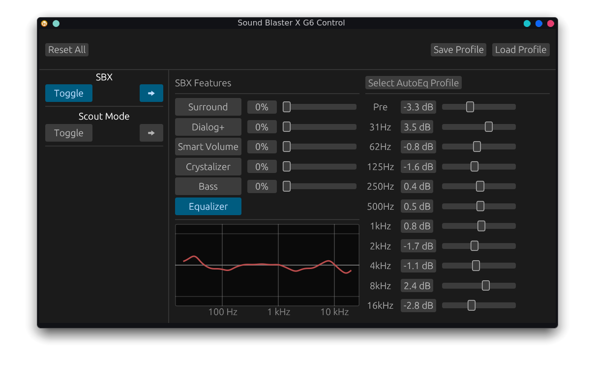

# Linuxblaster Control 
(because it sounds mildly funny) 

A native Linux GUI application to control the **Creative Sound BlasterX G6** USB DAC/Amp, with full [AutoEq](https://github.com/jaakkopasanen/AutoEq) integration. 



## Installation

You don't need to know anything about programming to use this. Download one file, install it like any other app, and you're done.

### 1. Download the right file

Go to the **[latest release](https://github.com/RizeCrime/linuxblaster_control/releases/latest)** and download **one** file from the *Assets* list:

| Your Linux                                                     | Download the file ending in |
|----------------------------------------------------------------|-----------------------------|
| **Ubuntu, Linux Mint, Pop!_OS, Zorin OS, elementary OS, Debian** | `_amd64.deb`                |
| **Fedora, Nobara, openSUSE**                                   | `.x86_64.rpm`               |
| **Anything else** (Arch, Manjaro, EndeavourOS, Bazzite, …), or if you'd rather not install anything | `-x86_64.AppImage` |
| **NixOS**                                                      | see [NixOS](#nixos) below   |

> [!TIP]
> Almost every desktop PC and laptop needs the `amd64` / `x86_64` files.
> The `arm64` / `aarch64` files are only for ARM computers, such as a Raspberry Pi or a Snapdragon laptop.

### 2. Install it

**`.deb` (Ubuntu, Mint, …):** double-click the file and click *Install*.
If double-clicking doesn't work, open a terminal in your Downloads folder and run:
```bash
sudo apt install ./linuxblaster-control_*_amd64.deb
```

**`.rpm` (Fedora, openSUSE):** double-click the file and click *Install*, or run:
```bash
sudo dnf install ./linuxblaster-control-*.x86_64.rpm      # Fedora
sudo zypper install ./linuxblaster-control-*.x86_64.rpm   # openSUSE
```

**AppImage:** no installation needed. Right-click the file → *Properties* → *Permissions* → enable *Allow executing file as program* (the exact wording depends on your desktop). Then double-click it.

### 3. Start it

Plug in your G6 and open **Linuxblaster Control** from your application menu (or double-click the AppImage).

The first time you start the AppImage, the app will ask to **allow access** to the G6. That's a one-time setup that lets your user account control the device. Click *Allow access* and enter your password. The `.deb` and `.rpm` packages do this automatically during installation.

### Uninstall

- `.deb`: `sudo apt remove linuxblaster-control`
- `.rpm`: `sudo dnf remove linuxblaster-control` (or `sudo zypper remove linuxblaster-control`)
- AppImage: delete the file. To also remove the access rule: `sudo rm /etc/udev/rules.d/70-linuxblaster-control.rules`

Your saved profiles stay in `~/.local/share/linuxblaster/profiles/`.

### NixOS

Add the flake to your configuration; this installs the app (with menu entry) and the access rule:

```nix
{
  inputs.linuxblaster_control.url = "github:RizeCrime/linuxblaster_control";

  outputs = { self, nixpkgs, linuxblaster_control, ... }: {
    nixosConfigurations.yourhostname = nixpkgs.lib.nixosSystem {
      modules = [
        linuxblaster_control.nixosModules.default
        {
          hardware.soundblaster-g6.enable = true;
        }
      ];
    };
  };
}
```

Or try it without installing: `nix run github:RizeCrime/linuxblaster_control`

## Troubleshooting

**"No Sound BlasterX G6 found"**
Make sure the G6 is connected with a USB *data* cable (not a charge-only cable) and switched on. The app connects by itself as soon as the G6 shows up.

**"Access is not allowed yet", even after clicking *Allow access***
Unplug the G6 and plug it back in, then click *Try again*.

**The AppImage doesn't start when double-clicked**
Check that it's allowed to run (see step 2). On some systems AppImages also need FUSE: install `libfuse2` (Ubuntu 22.04, Debian) or `libfuse2t64` (Ubuntu 24.04 and newer), or use the `.deb`/`.rpm` instead.

**My microphone isn't picked up**
Open *Mixer* → *Recording Source* and select **External Mic**. (The G6 starts on *Line In* on Linux.)

**My settings changed when I switched between Speakers and Headphones**
That's how the G6 works: it keeps a separate set of settings for each output.

**Something else is wrong**
Start the app from a terminal with `linuxblaster_control` (or `./Linuxblaster_Control-*.AppImage`) and [open an issue](https://github.com/RizeCrime/linuxblaster_control/issues) with what it prints.

## About

The app reads the current state from the G6 itself, so it always shows what the device is actually set to.
The G6 has two internal settings profiles, one for Headphones and one for Speakers; the app refreshes everything when you switch the output.
Changes made on the device itself (e.g. the SBX and Scout Mode buttons) and to the hardware mixer (e.g. the volume knob) show up while the app is running.
The app also saves its last settings and re-applies them on the next launch; see [Last State on Launch](#last-state-on-launch).

## Supported Features

- **State Reading**
	- Live link monitor (connected / reconnected / disconnected, Direct Mode, SBX, Scout, output)
	- Last-state restore on launch
- **Profiles**
	- Saving & Loading
	- Profile Save Location
- **SBX**
	- Surround Sound
	- Dialog+
	- Smart Volume (incl. Night & Loud Mode)
	- Crystalizer 
	- Bass 
	- Equalizer 
		- PreAmp
		- 10-band EQ
		- AutoEq Profiles
- **Playback**
	- Output Select 
	- DAC Filter
	- Direct Mode (full DSP bypass; controlled by the SBX switch)
- **Recording**
	- Mic Recording Volume & Monitoring
	- Mic Boost
	- Voice Clarity: Noise Reduction, Acoustic Echo Cancellation, Smart Volume
	- Mic EQ (Presets & individual Bands)
- **Decoder**
	- Normal, Full, and Night
- **Mixer**
	- Playback, Monitoring, and Recording Levels
	- Recording Source
- **Lighting**
	- On/Off & Color
- **System**
	- Virtual 7.1 headphones sink (1:1 port of the G6 downmixer APO, f64)
	- PipeWire volume sync with the active output
	- SINAD fix: hardware volume capped at −2.00 dB
- **Scout Mode** 

## Not-Implemented Features

- **Playback**
  - Speaker/Headphone Channel Configuration (Stereo/5.1/7.1)
- **Lighting**
  - Effects other than a static color (no captures yet)

**Audio Quality** (bit depth / sample rate) is not a setting of the device: whatever plays or records audio picks the format for each stream (on Linux that's usually PipeWire). Configure it there, e.g. with PipeWire's `default.clock.allowed-rates`.

### About the Mixer

The Mixer (and the volume/monitoring sliders in Recording) are the G6's own hardware controls, defined by the USB Audio Class standard. They're changed through ALSA, which only forwards them to the device, the same way Windows does. Nothing is processed in software, so recordings stay exactly as the hardware produces them.

## Profiles

Profiles are stored as JSON files in `~/.local/share/linuxblaster/profiles/`.
A profile applies to the output that is currently active (Speakers or Headphones).
Profiles from before v2.1 will have to be remade, the old format is no longer compatible.

### Applying a profile on startup

The G6 forgets its settings when it's reset or unplugged (lighting comes back on, effects are off, ...).
To get them back automatically, start the app with one of these options, e.g. in its autostart entry (`Exec=linuxblaster_control --apply-last`):

- `--apply-last` applies the profile you loaded or saved last in the app.
  The app remembers it from the first time you load or save a profile with this version.
- `--apply-profile <file>` applies the given profile file.

The profile is applied as soon as the G6 is connected, also if it only shows up a few seconds after the app started.
Only the settings that differ from what the device reports are written.

> [!IMPORTANT]
> The profile format is custom to this application and is **not compatible** with official Creative Sound Blaster Command profiles (.json or .xml) from Windows.

## System Tray

The app shows an icon in the system tray (KDE Plasma and most other desktops; GNOME needs the *AppIndicator* extension). Its menu can show or hide the window, switch the lighting on and off, and quit. A left click on the icon shows or hides the window.

Closing the window hides it in the tray. If there is no tray, closing the window quits as before.

| Flag                         | Effect                                                         |
|------------------------------|----------------------------------------------------------------|
| `--tray` (or `--minimized`)  | Start hidden in the tray, e.g. for autostart                   |
| `--minimize-to-tray`         | Minimizing the window also hides it in the tray (X11 only)     |
| `--no-tray`                  | No tray icon; closing the window quits                         |

To start the app in the tray when you log in, add `linuxblaster_control --tray` to your desktop's autostart (KDE: *System Settings → Autostart → Add → Add Application*, then add `--tray` to the command). If the tray isn't there yet when the app starts, it waits up to 10 seconds for it before showing the window instead.

## Direct Mode

Direct Mode is a full bypass of the G6's DSP. While it is on, SBX, the equalizer, Scout Mode, Voice Clarity/VoiceFx and the decoder are inactive; the app grays out the panes that cannot work and closes the AutoEQ wizard.

The SBX master switch is the only control: turning SBX off enters Direct Mode, turning it back on leaves it. The app also checks the device state every two seconds and never leaves SBX and Direct Mode on together.

Changing the mode makes the G6 re-enumerate its USB interfaces. Audio drops for about two seconds, the control endpoint disappears, and the app reopens it automatically. The status bar shows the current link state, Direct Mode, SBX, Scout, output and the number of reconnects.

## Last State on Launch

The app writes its current settings to `~/.local/share/linuxblaster/last_state.json` after a change (at most once every two seconds while dragging) and when the window closes. On the next launch it compares the file with the device and writes only the differences, so settings the G6 kept in NVRAM are not rewritten. The output is restored first (settings are stored per output), and SBX/Direct Mode last because they switch the DSP path and can re-enumerate the device. The speaker volume is intentionally not restored.

A corrupt or incompatible snapshot is renamed to `last_state.json.bad` and ignored, so it cannot block every launch. This is separate from the profiles in `~/.local/share/linuxblaster/profiles/`.

No separate daemon is needed: the app is the controller and restores its own state when it starts. It autostarts with the desktop session on KDE; if your desktop does not restore running applications, add the app's `.desktop` file to `~/.config/autostart/`.

## Virtual 7.1 Sink and Volume Sync

The System pane can install a virtual 7.1 sink for headphones. It is a PipeWire filter-chain that feeds the G6 Pro output. 7.1 PCM arrives at the sink and is downmixed by a **1:1 code port of the Sound BlasterX G6 downmixer APO** (`CMatrixEncoderEfxMod` from `KSUSBAPO64.dll`, fully decoded and verified bit-exact in g6-re). The port runs in **f64 instead of the original f32** — the only difference.

The installer ships the plugin with the app: `libg6ct_ladspa_f64.so` is compiled from the vendored MIT sources in `vendor/g6ct/`, carried inside the binary, and written to `~/.local/lib/linuxblaster/` on install. No source checkout, build step, or download is needed. The installer then writes a PipeWire config for the G6 sink that is actually attached and restarts `pipewire.service`; the app asks before that restart, because it interrupts every audio stream for a few seconds.

`vendor/g6ct/` is [g6-re](https://github.com/RizeCrime/g6-re) commit `68fd284`, where the downmixer was relicensed to MIT. The only difference is one string: the LADSPA `Copyright` field in `g6ct_ladspa.c` still said `GPL-3.0` at that commit and reads `MIT` here. The DSP sources are byte-identical, and the golden-render test in `cargo test` is the same value g6-re pins for its f64 build.

The toggle routes the default output between the G6 Pro sink (direct) and the virtual sink. When **sync volume** is enabled, the active sink's PipeWire volume is the single volume control and the inactive gain stage stays at 100%; the volume is carried over when the output switches.

The **SINAD fix** limits the hardware Speaker control to raw `124/128` — 97% on the slider, which is −2.00 dB. The cap is enforced on every write, and if another client or the knob pushes the hardware volume above it, the app restores the cap automatically. It is **off by default**, because while it is on it also overrides volume set by other clients; enable it only if you hear the distortion it fixes.

## For Developers

### Building from Source

You need a Rust toolchain, a C compiler (`cc`) for the vendored g6ct plugin, and these development packages:

| Distro          | Packages                                    |
|-----------------|---------------------------------------------|
| Debian / Ubuntu | `pkg-config libudev-dev libasound2-dev`     |
| Fedora          | `pkgconf systemd-devel alsa-lib-devel`      |
| Arch            | `pkgconf systemd-libs alsa-lib`             |

`build.rs` compiles `vendor/g6ct` for the target. It runs `cc`, or `CC` if set; **cross-compiling** requires the target-qualified `CC_<target>` (for example `CC_aarch64_unknown_linux_gnu`) and stops with an error without it, instead of embedding a host-architecture plugin in the binary. `CFLAGS` is ignored on purpose: `-ffp-contract=off` and `-fno-fast-math` are part of the bit-exact contract with the APO.

The plugin build is covered by `cargo test`: it loads the built `.so` through the LADSPA ABI and compares a deterministic 48 kHz render against the golden hash pinned in g6-re, plus the channel-mask and stereo-bypass cases.

```bash
git clone https://github.com/RizeCrime/linuxblaster_control.git
cd linuxblaster_control
cargo build --release
./target/release/linuxblaster_control
```

Without the packages, you'll also need the udev rule for access to the device: copy [`packaging/70-linuxblaster-control.rules`](packaging/70-linuxblaster-control.rules) to `/etc/udev/rules.d/` (or use the *Allow access* button in the app).

The device is accessed through the kernel's hidraw interface. The app never resets the USB device: a reset wakes the HID endpoint but leaves the audio interface unusable until the next re-enumeration, which breaks playback for the rest of the session. Instead it waits and retries the endpoint, reopening the hidraw node when the device re-enumerated.

To print the current device state without the GUI (read-only):

```bash
cargo run --example dump_state
```

### Nix

```bash
nix develop   # development shell with all dependencies
nix build     # build the package
```

### Cold boot

On some machines the G6 comes out of a cold boot with a dead HID endpoint and a broken first audio enumeration (`selector reported illegal value`). The app cannot repair that while it runs: resetting the device would break audio for the whole session. The optional helper does the reset once, at boot, before PipeWire opens the device:

```bash
sudo packaging/coldboot/install.sh
```

It runs from the G6's udev `add` event, is not part of the boot transaction, and does not delay the display manager. It holds `snd-usb-audio` back from the first enumeration and loads it after a clean re-enumeration. **Side effect:** the blacklist is per module, so another USB audio device attached at boot needs `sudo modprobe snd-usb-audio` once. Details, verification steps and removal: [`packaging/coldboot/README.md`](packaging/coldboot/README.md). The System pane exposes the same install behind a button.

### Release Packages

[`packaging/build-release.sh`](packaging/build-release.sh) builds the `.tar.gz`, `.deb`, `.rpm` and AppImage for the current architecture into `dist/`.
On GitHub, the [Release workflow](.github/workflows/release.yml) runs it for x86_64 and aarch64 whenever a release is published and attaches the files to the release. The package version is taken from the release tag.

## ⚠️ Development Status

**This project is in active development and should be considered experimental.**

### Current Limitations

- **Limited testing** — Tested only on the developer's hardware.
- The USB protocol was reverse-engineered and may not cover all device features.
- Some features available in the Windows Sound Blaster Command software are not yet implemented.

## Technical Details

- **Vendor ID:** `0x041e` (Creative Technology)
- **Product ID:** `0x3256` (Sound Blaster X G6)
- **Interface:** 4 (HID control interface)

Communication uses 65-byte HID reports with a custom protocol consisting of DATA and COMMIT packets.

Find the details in [UsbProtocol](UsbProtocol.md).  

## Contributing

Contributions are welcome! If you have a Sound Blaster X G6 and want to help:

- Report bugs or missing features
- Help reverse-engineer additional functionality

## Acknowledgments

~~This project builds upon the USB protocol research from the [soundblaster-x-g6-cli](https://github.com/nils-skowasch/soundblaster-x-g6-cli) project by Nils Skowasch, which provided initial USB packet captures and protocol documentation. Additional reverse engineering (including the 10-band EQ protocol) was done for this project.~~  
The initial versions of this project were based on the [soundblaster-x-g6-cli](https://github.com/nils-skowasch/soundblaster-x-g6-cli) project. However, it turns out that this work was misleadingly incomplete. What was thought to be a Commit Push from the Host was actually the Device reporting back a queried value, just as an example. I have done a bunch of extra reverse engineering to figure out the actual full protocol (see the sniffer directory), at least I _think_ that I've got the full picture this time; but that's also what I thought before, so who knows /shrug. 

## AI Disclaimer 

~~With v2 I can proudly say that almost all Code was written by me (In v1 the GUI was written by AI (and you could tell)), and AI only filled out match arms and enums for me. 
I also use AI liberally to beautify anything user-facing (including this README and most other .md files).  
Oh and the math for the EQ curve visualizer was also done by AI.~~
After getting the project to a "good enough" state for my own purposes, I sadly don't have the time for this project anymore.  
It will mostly be maintained by an LLM under my supervision from v2.2 and onwards. 

## License

MIT License — see [LICENSE](LICENSE) for details. The vendored g6ct downmixer in `vendor/g6ct/` is MIT as well.
